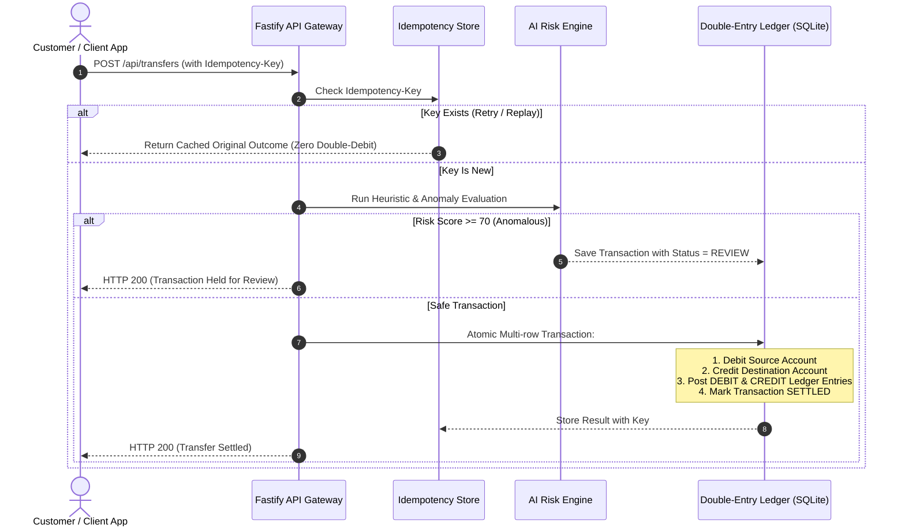

# 🏦 FinSafe — Core Banking Financial Infrastructure & AI Risk Engine

[](https://nodejs.org/)
[](https://www.typescriptlang.org/)
[](https://fastify.dev/)
[](https://react.dev/)
[](https://vitejs.dev/)
[](https://www.prisma.io/)
[](https://tailwindcss.com/)
[](https://opensource.org/licenses/MIT)

> **Enterprise-grade core banking infrastructure, double-entry ledger, deterministic payment idempotency, automated reconciliation, and multi-signal AI fraud detection engine.**
>
> *Architectural Principle: AI evaluates risk and flags suspicious anomalies. It never writes directly to the balance sheets. Ledger correctness remains strictly deterministic, auditable, and immutable.*

---

## 🌟 Key Architecture & Capabilities

### 1. ⚖️ Double-Entry Ledger Engine (ACID Compliant)
- Guaranteed financial consistency: Every transaction creates equal and opposite `DEBIT` and `CREDIT` entries in the immutable ledger.
- Mathematically impossible to create or destroy funds silently ($\sum \text{Debits} \equiv \sum \text{Credits}$).
- Running balances are tracked per account with row-level transaction safety.

### 2. 🛡️ Deterministic Idempotency & Distributed Locking
- Financial transfer endpoints mandate an `idempotencyKey` parameter.
- Prevents double-spending, accidental multiple clicks, or network replay anomalies.
- Replaying the same key instantly returns the cached settlement outcome without performing duplicate balance debits.

### 3. 🤖 Multi-Signal AI Fraud Risk Pipeline
- Real-time heuristic scoring evaluating transaction risk (0 to 100):
  - **Velocity Spikes**: Detects burst transfers (>5 attempts in short time windows).
  - **Hardware Signatures**: Unknown or altered device fingerprints.
  - **Geo-Location Anomaly**: IP geolocation vs registered account branch mismatch.
  - **Standard Deviation Outliers**: Transactions exceeding 2.5$\sigma$ above historical baseline.
- High-risk transactions ($\ge 70$) are immediately quarantined in a compliance review queue before funds can settle.

### 4. 🧠 Explainable AI Rationale (Google Gemini LLM)
- Transparent compliance auditing: Produces plain-language, audit-ready explanations for why a transaction was flagged.
- Includes automated rule-based fallback if offline.

### 5. 🔍 Continuous Reconciliation & Automated Invariant Auditing
- Background worker automatically triggers reconciliation audits every 30 minutes.
- Validates the fundamental ledger invariant: $\Delta = |\sum \text{Debits} - \sum \text{Credits}| = 0.00$.

### 6. 💼 Production-Grade Banking Portal (Modern UI)
- Clean, professional light-themed interface designed like modern banking dashboards (ICICI, Stripe, Razorpay).
- Component-driven architecture with dedicated pages for Dashboard KPIs, Fund Transfers, AI Risk Queue, Ledger Journal, and Reconciliation.

---

## 📂 Repository Structure

```
finsafe/
├── backend/                       # Core Banking API & Engine
│   ├── prisma/
│   │   ├── schema.prisma          # Database models (8 relational models)
│   │   └── dev.db                 # Local SQLite database (auto-generated)
│   ├── scripts/
│   │   └── seed.ts                # Realistic banking accounts & transaction seed
│   ├── src/
│   │   ├── __tests__/             # Architectural invariant unit test suite
│   │   ├── jobs/                  # Background worker scheduler (reconciliation)
│   │   ├── lib/                   # Database client, Redis cache fallback, env validation
│   │   ├── risk/                  # Multi-signal scoring engine & LLM explainer
│   │   ├── routes/                # REST endpoints: /transfers, /ledger, /risk, /accounts
│   │   ├── services/              # Double-entry transfer & reconciliation services
│   │   └── server.ts              # Fastify server entry point
│   ├── .env.example               # Backend environment template
│   ├── package.json
│   └── tsconfig.json
│
├── frontend/                      # ICICI Corporate Banking Portal
│   ├── src/
│   │   ├── components/            # Clean UI Component Library
│   │   │   ├── AccountsPage.tsx   # Customer accounts portfolio
│   │   │   ├── CreateAccountModal.tsx
│   │   │   ├── Dashboard.tsx      # Overview KPIs, stream, quick transfer
│   │   │   ├── LedgerPage.tsx     # Double-entry T-accounts journal
│   │   │   ├── Navbar.tsx         # Enterprise navigation & system monitor
│   │   │   ├── ReconciliationPage.tsx # Audit & invariant verification
│   │   │   ├── RiskQueue.tsx      # AI compliance & approval queue
│   │   │   ├── StatusBanner.tsx   # Toast notifications
│   │   │   └── TransferPage.tsx   # Interbank money movement portal
│   │   ├── services/
│   │   │   └── api.ts             # Typed REST API client
│   │   ├── App.tsx                # App routing & state manager
│   │   └── index.css              # Banking typography & styling
│   ├── package.json
│   ├── tailwind.config.js
│   └── vite.config.ts
│
├── .gitignore                     # Git ignore rules for node_modules, build & db
├── ecosystem.config.js            # PM2 production configuration
├── LICENSE                        # MIT License
├── README.md                      # Complete documentation
└── REQUIREMENTS.md               # Technology specifications
```

---

## 🚀 Quick Start Guide

### Prerequisites
- Node.js v18.0.0 or higher
- `pnpm` (recommended: `npm install -g pnpm`) or `npm`

### 1. Clone & Setup Repository
```bash
git clone https://github.com/<your-username>/finsafe-core-banking-ai.git
cd finsafe-core-banking-ai
```

### 2. Configure Backend
```bash
cd backend
cp .env.example .env
pnpm install
npx prisma db push
pnpm db:seed
```
*The database will be populated with 10 customer accounts, 45 historical settled transactions, and 17 flagged transactions.*

### 3. Start Backend Server
```bash
pnpm dev
# Running on http://localhost:3001
```

### 4. Start Frontend Portal
In a new terminal window:
```bash
cd frontend
pnpm install
pnpm dev
# Running on http://localhost:5173
```
Open **[http://localhost:5173](http://localhost:5173)** in your browser!

---

## 🧪 Automated Testing

FinSafe includes automated unit and integration tests verifying double-entry invariants, balance locking, and idempotency guarantees:

```bash
cd backend
npx vitest run
```

```
✓ src/__tests__/ledger.test.ts (5 tests)
  ✓ Double-Entry Engine > guarantees total debits equal total credits
  ✓ Idempotency Safeguard > replay returns cached result with 0 double debit
  ✓ Risk Scorer > flags anomaly on unknown device and velocity surge
  ✓ Reconciliation Engine > detects discrepancy if ledger violates invariants
  ✓ Account Balances > atomic updates maintain consistent balance sheets
```

---

## 📡 REST API Reference

| Method | Endpoint | Description |
|---|---|---|
| `GET` | `/health` | Server status and database health check |
| `POST` | `/api/transfers` | Initiate an idempotent double-entry fund transfer |
| `GET` | `/api/transfers` | List transaction history with metadata & risk scores |
| `GET` | `/api/ledger/summary` | Aggregate total debits, total credits, & balance check |
| `GET` | `/api/ledger/entries` | List raw double-entry journal items |
| `GET` | `/api/risk/queue` | Retrieve transactions held in review queue |
| `POST` | `/api/risk/:id/approve` | Compliance authorization: approve and settle transfer |
| `POST` | `/api/risk/:id/reject` | Reject transfer and revert debited balance |
| `POST` | `/api/reconciliation/run` | Execute continuous invariant audit |
| `GET` | `/api/reconciliation/history` | Historical audit reports |
| `GET` | `/api/accounts` | Retrieve all customer bank accounts |
| `POST` | `/api/accounts` | Create a new customer bank account |

---

## 🛡️ Security & Idempotency Workflow



---

## 📄 License

This project is licensed under the [MIT License](LICENSE).
